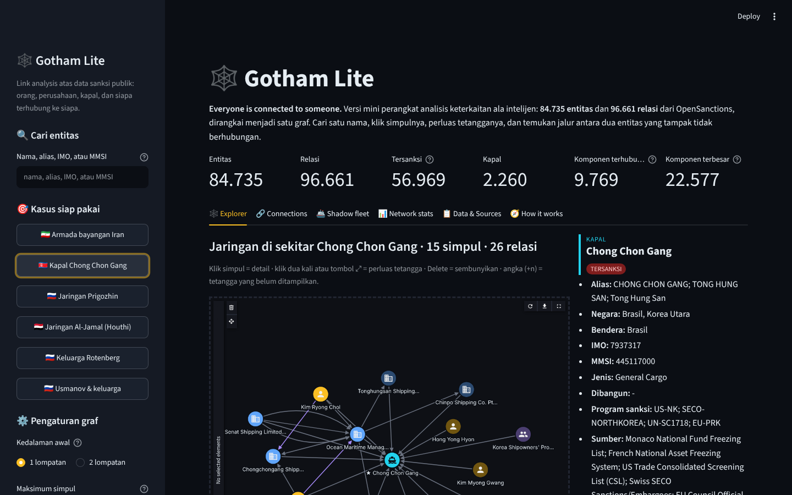
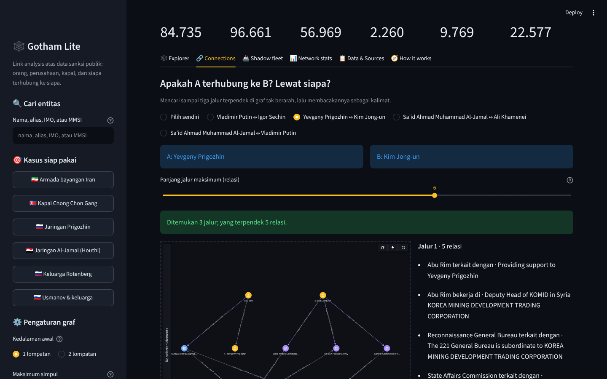
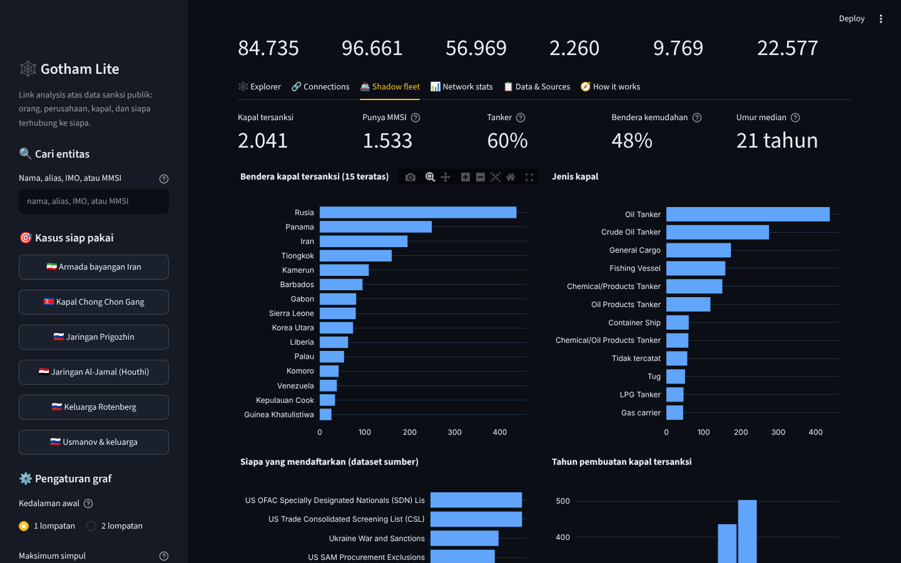
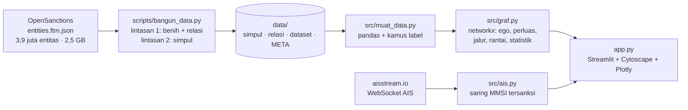

# 🕸️ Gotham Lite

> Versi mini perangkat analisis keterkaitan (*link analysis*) ala intelijen, dibangun dari data sanksi publik:
> **siapa memiliki apa, siapa keluarga siapa, kapal mana milik siapa**, dalam satu graf interaktif yang bisa diklik,
> diperluas, dan ditelusuri jalurnya. Data dari OpenSanctions (84.735 entitas, 96.661 relasi), digambar dengan
> Cytoscape.js di dalam Streamlit, dianalisis dengan networkx.

## 🇬🇧 In English

**Everyone is connected to someone.** Gotham Lite is a small, open link-analysis workbench in the spirit of the tools
intelligence analysts use: people, companies, vessels and aircraft from public sanctions data, wired into one graph you
can search, click, expand and path-find through.

- **Explore** a network around any name: click a node for details, double-click to pull in its hidden neighbours, delete to prune.
- **Connect** two entities and read the shortest paths between them as plain sentences (*A owns B · B directs C*).
- **Track the shadow fleet**: 2,000+ sanctioned vessels by flag, type, age and listing authority, with ownership chains and a live AIS match.
- **Measure the network**: hubs, connected components, degree distribution, and non-listed entities with the most sanctioned neighbours.

Built with Python, pandas, networkx, Plotly, Streamlit and the `st-link-analysis` Cytoscape component. Data: the
OpenSanctions *default* collection (3.9 M entities, 2.5 GB) pruned to the connected part around sanctioned entities by a
two-pass streaming script; refreshed monthly by GitHub Actions. Engineering: pure logic in `src/` with 33 pytest tests,
UI in `app.py`. *The rest of this README is in Indonesian.*

**🚀 Coba langsung di browser:** [gotham-lite.streamlit.app](https://gotham-lite.streamlit.app)



> ℹ️ **Disclaimer.** Seluruh entitas dan relasi berasal dari **OpenSanctions**, agregator terbuka atas daftar sanksi dan
> daftar pengawasan resmi (OFAC AS, Uni Eropa, OFSI Inggris, DK PBB, NSDC Ukraina, SECO Swiss, dan lain-lain) beserta
> pengayaan dari register perusahaan publik dan Wikidata. Keberadaan sebuah nama di graf ini **bukan** bukti pelanggaran;
> entitas yang tidak tersanksi tampil semata karena punya relasi tercatat dengan entitas tersanksi. Proyek ini edukatif dan
> portofolio pribadi, bukan alat kepatuhan, dan tidak berafiliasi dengan instansi mana pun.

## Latar belakang

Perangkat seperti Palantir Gotham atau i2 Analyst's Notebook terkenal karena satu kemampuan: mengambil ribuan catatan
yang berserakan dan menampilkannya sebagai **graf** yang bisa dijelajahi. Analis mengklik satu nama, melihat siapa saja
yang terhubung, memperluas simpul yang mencurigakan, dan bertanya "lewat siapa A sampai ke B?". Perangkatnya mahal dan
tertutup, tetapi idenya tidak rumit: entitas sebagai simpul, relasi sebagai sisi, dan beberapa algoritma graf dasar.

Datanya pun tersedia terbuka. **OpenSanctions** menggabungkan ratusan daftar sanksi resmi ke dalam satu format
(FollowTheMoney), dan yang membuatnya istimewa: **relasi ikut dicatat**. Siapa pemilik tanker yang disanksi, siapa
direktur perusahaan cangkangnya, siapa istri dan anak oligarkinya. Proyek ini menyatukan keduanya: graf dari data
OpenSanctions, kanvas Cytoscape untuk mengkliknya, dan networkx untuk menjawab pertanyaan keterhubungan. Sekaligus
latihan nyata tentang pemrosesan data besar secara streaming, pemangkasan hub, BFS, jalur terpendek, dan komponen
Streamlit berbasis JavaScript.

## Fitur

| Tab | Isi |
|---|---|
| 🕸️ Explorer | Cari nama/alias/IMO/MMSI atau pilih kasus siap pakai (armada bayangan Iran, kapal Chong Chon Gang, jaringan Prigozhin, Al-Jamal, Rotenberg, Usmanov). Graf Cytoscape dengan warna per tipe (orang, perusahaan, organisasi, kapal, pesawat) dan terang/redup untuk tersanksi/tidak. Klik simpul = panel detail (alias, negara, program sanksi, sumber, IMO/MMSI, tautan OpenSanctions); klik dua kali = perluas tetangga; Delete = sembunyikan; angka `(+n)` = tetangga yang belum tampil |
| 🔗 Connections | Dua entitas → sampai tiga jalur terpendek (panjang maksimum bisa diatur), digambar sebagai graf dan dibacakan sebagai kalimat per langkah; pasangan contoh: Putin ↔ Sechin, Prigozhin ↔ Kim Jong-un, Al-Jamal ↔ Khamenei |
| 🚢 Shadow fleet | 2.041 kapal tersanksi: bendera, jenis, otoritas pendaftar, tahun pembuatan, porsi tanker dan bendera kemudahan, umur median; tabel dengan filter dan pencarian; rantai kepemilikan sebuah kapal sampai empat lapis; **Live AIS**: dengarkan siaran aisstream.io dan tampilkan kapal tersanksi yang sedang memancar di peta |
| 📊 Network stats | Entitas per tipe dan status, jenis relasi, distribusi derajat, komponen terhubung terbesar, hub per tipe, "tidak dalam daftar tetapi dekat" (entitas tak tersanksi dengan tetangga tersanksi terbanyak), negara dan program sanksi |
| 📋 Data & Sources | Sumber, cara pemangkasan, keterbatasan, tabel dataset sumber dengan tautan, tombol download simpul/relasi/kapal |
| 🧭 How it works | Diagram alur data, peran setiap modul, penjelasan skema FollowTheMoney dan alasan memakai Cytoscape |
| 🎓 Learning mode | Toggle di sidebar: setiap tab menampilkan expander berisi penjelasan konsep (BFS, jalur terpendek, komponen, paparan) dan potongan kode |




## Temuan menarik dari snapshot ini

- **Graf sanksi sangat terfragmentasi**: 9.769 komponen terhubung, tetapi satu komponen raksasa berisi 22.577 entitas
  (27%) yang menyatukan Rusia, Iran, dan Korea Utara lewat perusahaan perantara. Prigozhin dan Kim Jong-un berjarak lima relasi.
- **Armada bayangan terlihat di angka**: dari 2.041 kapal tersanksi, 48% berbendera kemudahan, umur median 21 tahun,
  dan jenis terbanyak tanker minyak. Bendera terbanyak: Rusia, Panama, Iran, Tiongkok, Kamerun.
- **"Tidak dalam daftar tetapi dekat"** didominasi pihak netral yang menyentuh banyak nama: partai politik Turki, badan
  klasifikasi kapal (Bureau Veritas, Lloyd's Register), dan asosiasi asuransi P&I. Pola ini mengingatkan bahwa jumlah
  tetangga tersanksi bukan ukuran kesalahan.
- Simpul orang paling terhubung bukan nama terkenal, melainkan direktur nominee Rusia yang mengurus puluhan perusahaan
  sekaligus, pola klasik perusahaan cangkang.

## Cara menjalankan

```bash
git clone https://github.com/Avalon2222/gotham-lite.git
cd gotham-lite
python -m venv .venv && source .venv/bin/activate   # Windows: .venv\Scripts\activate
pip install -r requirements.txt
streamlit run app.py
```

Buka `http://localhost:8501`. Aplikasi membaca snapshot di `data/` (±10 MB) sehingga berjalan tanpa internet; memuat graf
pertama kali memerlukan ±3 detik. Jalankan pengujian dengan `python -m pytest tests/ -v` (33 tes, tanpa internet).

**Live AIS (opsional).** Daftar gratis di [aisstream.io](https://aisstream.io), lalu simpan kuncinya di
`.streamlit/secrets.toml` (lokal) atau menu *Secrets* Streamlit Cloud:

```toml
[aisstream]
api_key = "kunci-kamu"
```

**Memperbarui data.** `python scripts/bangun_data.py` mengunduh koleksi *default* OpenSanctions (±2,5 GB) dan membangun
ulang `data/` dalam ±3 menit. GitHub Actions menjalankannya otomatis setiap tanggal 1.

## Cara kerja (ringkas)



| Modul | Yang dilakukan |
|---|---|
| `scripts/bangun_data.py` | Membaca 2,5 GB JSON Lines secara streaming dalam dua lintasan: (1) kumpulkan id entitas bertopik sanksi dan semua relasi, (2) tulis simpul yang dibutuhkan. Relasi dari register perusahaan hanya disimpan bila menyentuh orang/kapal tersanksi, maksimum 60 tetangga luar per benih |
| `src/muat_data.py` | Baca CSV dengan tipe yang benar; kamus tipe entitas, jenis relasi, nama negara, bendera kemudahan |
| `src/graf.py` | `MultiDiGraph` networkx; pencarian berperingkat; ego-graf BFS dengan prioritas; perluasan; elemen Cytoscape; jalur terpendek (Yen); rantai pemilik kapal (DFS); paparan; statistik jaringan |
| `src/ais.py` | Klien WebSocket aisstream.io, pengurai pesan posisi, pencocokan MMSI |
| `app.py` | Sidebar, enam tab, komponen `st-link-analysis` dengan callback klik/expand/remove, grafik Plotly, learning mode |
| `tests/` | 33 tes pytest: graf buatan kecil untuk setiap fungsi, pengujian skrip pembangun end-to-end, dan konsistensi snapshot asli |

Penjelasan konsep (FollowTheMoney, BFS, jalur terpendek, komponen terhubung, hub, paparan, AIS) ada di
[docs/BELAJAR.md](docs/BELAJAR.md); latihan bertingkat di [docs/LATIHAN.md](docs/LATIHAN.md); rincian sumber di
[data/SUMBER_DATA.md](data/SUMBER_DATA.md).

## Struktur repo

```
gotham-lite/
├── app.py                     # UI Streamlit
├── src/
│   ├── muat_data.py           # pemuatan data + kamus label
│   ├── graf.py                # inti analisis keterkaitan (networkx)
│   └── ais.py                 # klien aisstream.io
├── scripts/bangun_data.py     # pembangun snapshot dari OpenSanctions
├── data/                      # simpul.csv.gz, relasi.csv.gz, kapal_tersanksi.csv, dataset.csv, META.json
├── tests/                     # pytest
├── docs/                      # BELAJAR.md, LATIHAN.md, screenshots/
└── .github/workflows/         # tests.yml, perbarui-data.yml (bulanan)
```

## Keterbatasan

- Nama di graf bukan bukti pelanggaran; data OpenSanctions menggabungkan banyak sumber dengan kualitas berbeda.
- Entitas tersanksi tanpa relasi tercatat (mayoritas daftar) sengaja tidak dimuat; graf ini tentang keterkaitan, bukan
  penyaringan nama.
- Pemangkasan 60 tetangga per benih membuat hub besar tampak lebih kecil dari aslinya.
- `UnknownLink` berarti sumber menyebut keterkaitan tanpa jenis yang jelas.
- Cakupan penerima aisstream tidak merata; kapal yang mematikan AIS tidak akan terdengar.

## Rencana berikutnya

- Skor risiko berbasis PageRank berpersonalisasi dari simpul tersanksi.
- Deteksi komunitas (Louvain) untuk mewarnai gugus di dalam komponen raksasa.
- Linimasa: kapan setiap relasi dan sanksi mulai tercatat.
- Ekspor subgraf ke GraphML/Gephi.

## Lisensi

Kode: MIT. Data OpenSanctions: [CC BY-NC 4.0](https://www.opensanctions.org/licensing/) (non-komersial dengan atribusi).
